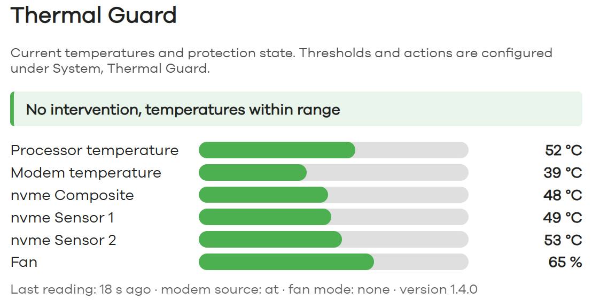
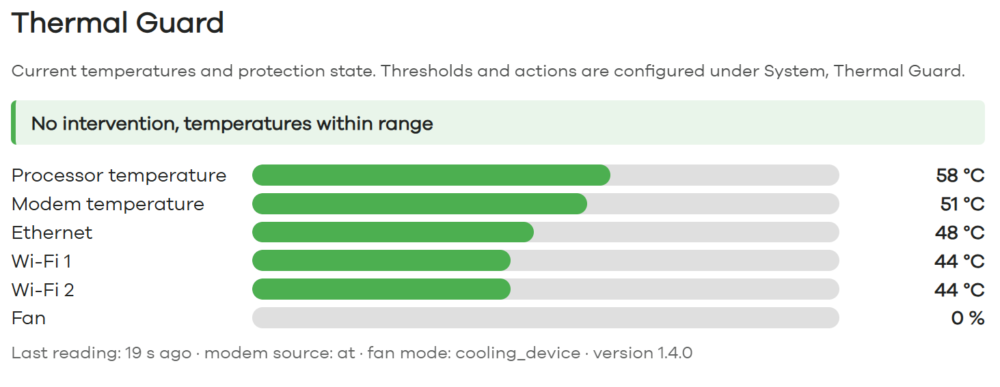
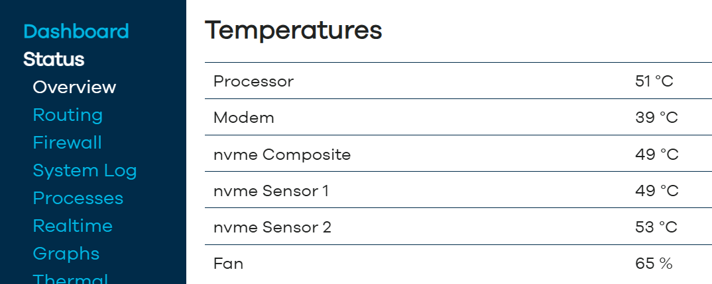
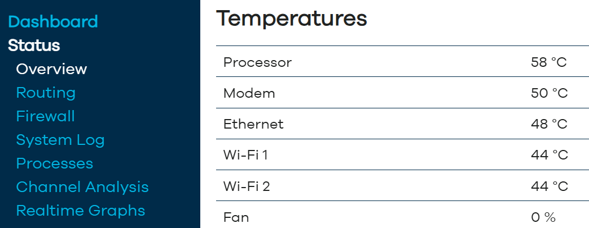
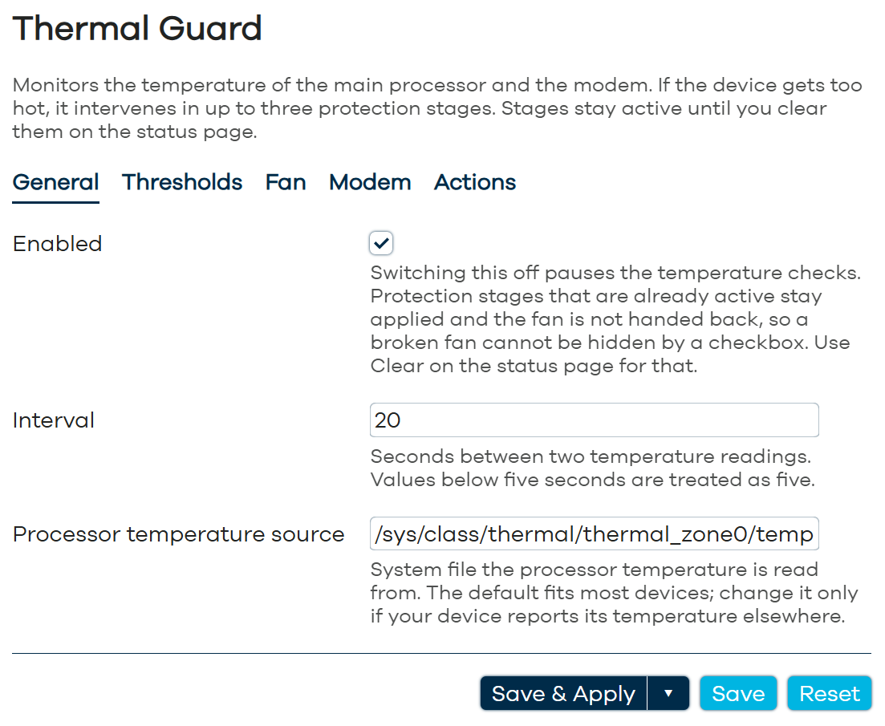
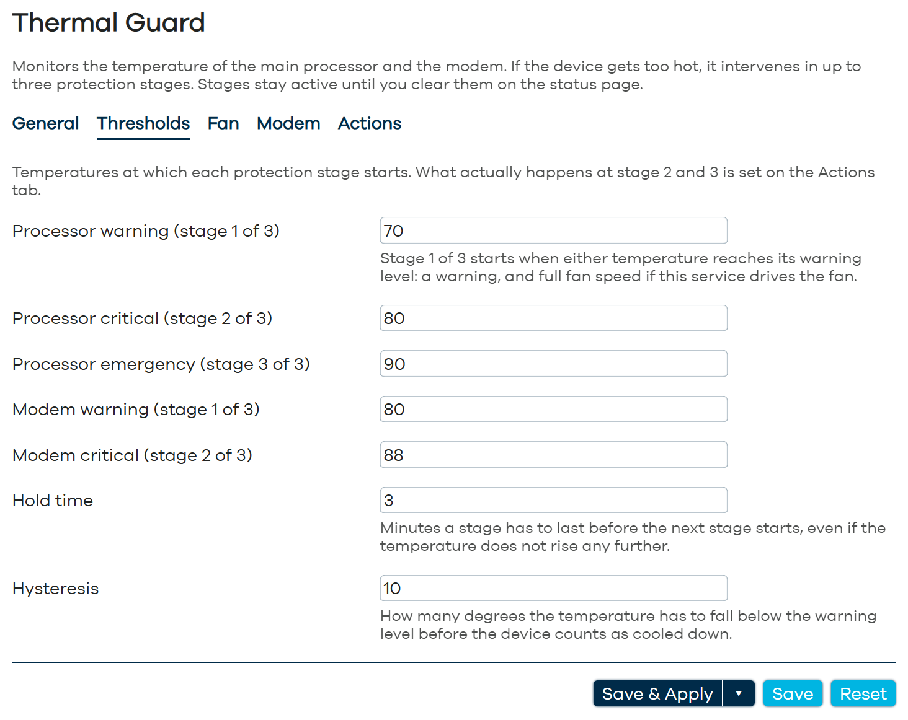
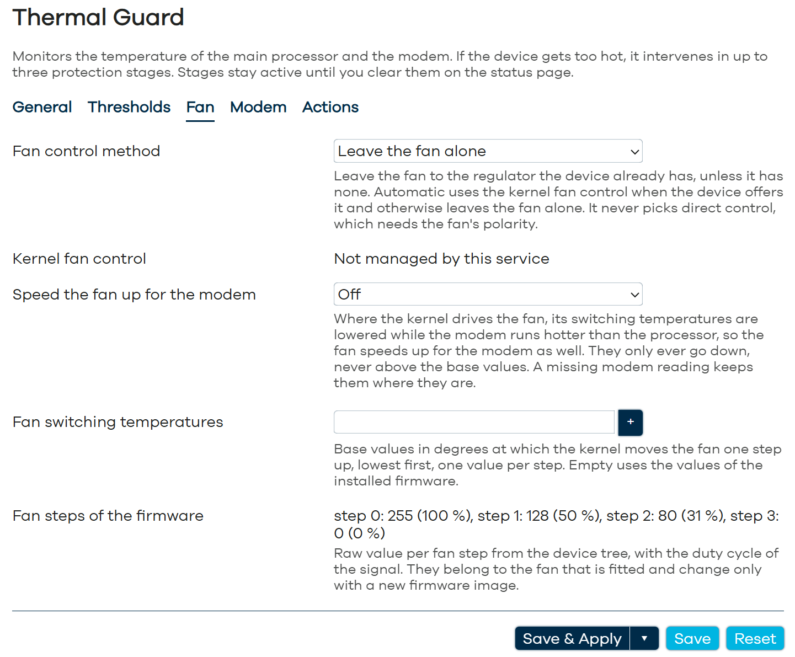
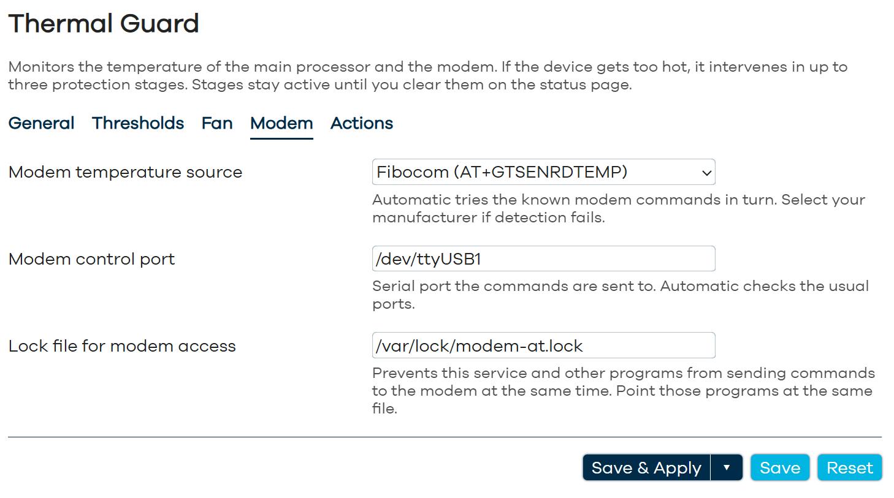
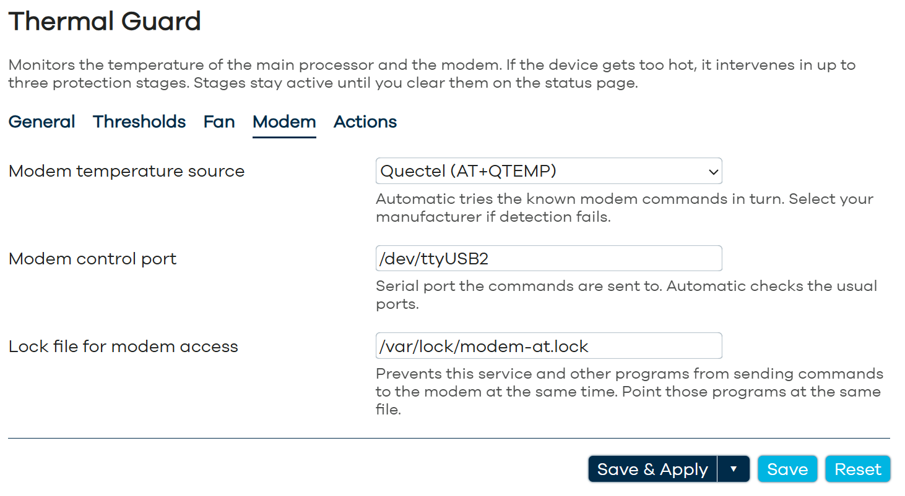
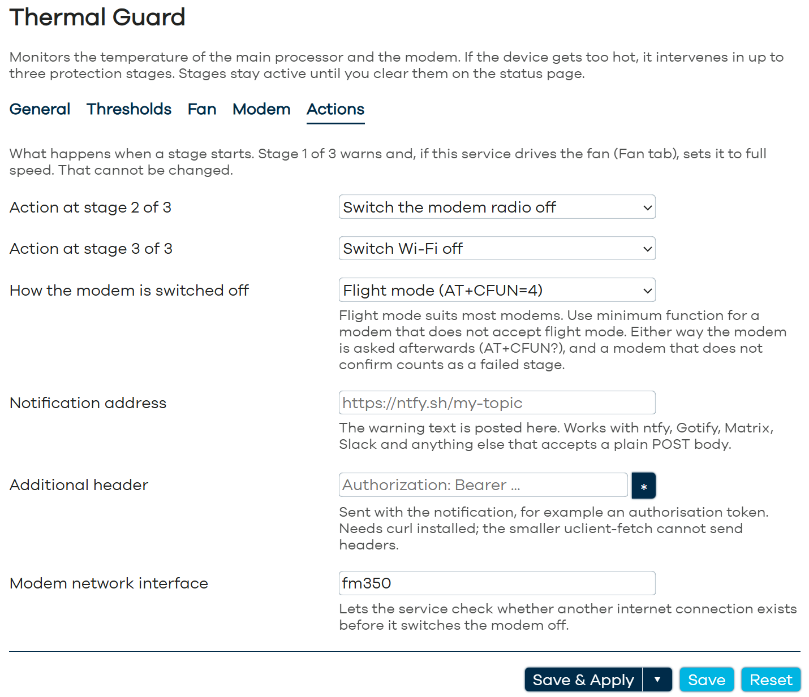

# thermal-guard

Overheating protection for OpenWrt routers with staged mitigation.



## Why this exists

The idea for this project came after a fan malfunction on my Banana Pi R3 Mini
damaged its Fibocom FM350-GL 5G module beyond repair. An inexpensive part
failed and took a much pricier one with it. Since one of my BPI R3 Minis runs
in a motorhome, I did not want to go through that again and set out to build
something that prevents it. This package is the result.

A better fan controller would not have helped: the one on the board was
convinced it had the fan at full speed. What was missing was something that
ignores what the fan is supposed to be doing and only looks at the temperature.

**This is not a fan controller.** OpenWrt has several of those and they do the
job better: they map temperature onto a curve and keep the box in its normal
band. This one does nothing at all until a threshold is crossed, and then does
something drastic that does not undo itself. Thermostat and thermal fuse, two
layers rather than two opinions.

So where a fan controller is already installed, leave it in charge: `fan_mode`
is `none` by default, and that is the regular configuration for such a board,
not a workaround. The built-in fan handling exists for boards that have nothing else,
and "force it to maximum" is a poor substitute for a curve. What this package
adds is the layer above: the one that assumes the controller can fail, or can
be wrong, and acts on the temperature rather than on what the fan reports.

A fan that stops is rarely noticed until something dies. `thermal-guard` watches
SoC and modem temperature and, when the box runs hot, escalates in three stages:

| Stage | Default action | Triggered by |
|---|---|---|
| 1 of 3 | Warning; fan forced to full speed where `fan_mode` lets the daemon drive it | `cpu_warn` or `modem_warn` reached |
| 2 of 3 | Modem radio off (`AT+CFUN=4`) | `cpu_crit`/`modem_crit`, or stage 1 held for `hold_minutes` without any drop |
| 3 of 3 | Wi-Fi off | `cpu_emergency`, or stage 2 held for `hold_minutes` while still climbing |

The web interface counts stages from one, the daemon and the status file count
them from zero, so stage 1 of 3 is `stage=0` in `thermal-guard status`. What
stages 2 and 3 do is configurable; the table shows the defaults. Each built in
action is read back rather than assumed: the modem is asked for its state
(`AT+CFUN?`), `interface_down` waits for netifd to report the interface down,
`wifi_off` waits for netifd to report no enabled radio up, and a forced fan is
read back from the cooling device and its zone or from the PWM files. An action
that does not confirm counts as failed, and the failure is notified. A `command`
hook counts by its exit code.

Three design decisions worth knowing before you deploy it:

* **Stages never roll back on their own.** Cooling down is reported once, the
  stage stays. A fan that failed once will fail again, and a silent recovery
  hides the fault. Clearing is an operator decision: `thermal-guard reset`. The
  one exception is the optional automatic recovery of stage 2 of 3, see below.
* **A reboot does not clear them either.** A stage change is mirrored to
  `/etc/thermal-guard/state`, and the daemon reapplies it at startup. The box
  did not get a new fan while it was down, so coming back up with the modem
  enabled would just repeat the incident. The restore is logged and notified.
* **A crash leaves the fan running.** The daemon only hands the fan back on an
  explicit reset, so dying mid-incident is the safe direction.

If a restored stage ever locks you out, reach the box over a wired port or
serial and run `thermal-guard reset`. Only a device that reached a stage whose
action is `wifi_off` or `interface_down` (stage 3 of 3 with the defaults) comes
back from a reboot with that connection still off, and such a device has a fan
and a modem, so it has wired ports too.

Every transition needs two consecutive hits, which keeps sensor glitches from
triggering anything. What a missing reading does depends on the transition:

* **A threshold** (`cpu_warn`, `modem_warn`, `cpu_crit`, `modem_crit`,
  `cpu_emergency`) needs a reading. A missing one does not count.
* **Stage 1 of 3 to 2 of 3 on time alone** looks for a reading that dropped
  below the one taken when stage 1 of 3 began. A missing reading is no drop,
  so it never delays this step.
* **Stage 2 of 3 to 3 of 3 on time alone** needs a reading above the one taken
  when stage 2 of 3 began. A missing reading never escalates: a box that loses
  its sensors in stage 2 of 3 stays there, and Wi-Fi is not switched off on no
  data. A processor sensor that does not read is reported once as `blind`.
* **The cooled report** counts a missing reading as cool. **Automatic
  recovery** never does, see below.

A reference that was missing at stage entry is taken from the first reading
after the gap.

Escalating from stage 1 of 3 on time alone, when the temperature has not dropped, is
the part that earns its keep. The guard never asks whether the fan turned; it
asks whether the box got cooler. That covers a fan that failed, a fan cable
that came off, and the case that prompted this package: a fan controller whose
pwm polarity was configured the wrong way round, which stopped the fan while
reporting that it had gone to full speed. No software can tell those apart on
a board without a tachometer, and none of them have to be told apart, because
the answer is the same. Set `hold_minutes` with that in mind: it is how long a
stage is given to prove it worked before the next one starts.

## Screenshots

The status page on two boards: a Banana Pi R3 Mini with a Fibocom modem, an NVMe
drive and the MediaTek vendor Wi-Fi driver, where another program drives the fan,
and a GL-iNet GL-X3000 with a Quectel modem, where the kernel does. Wi-Fi 1 and 2
come from `iwpriv` on the one and from hwmon on the other.

<table>
  <tr>
    <td></td>
    <td></td>
  </tr>
</table>

The same readings in a block on the LuCI overview page:

<table>
  <tr>
    <td></td>
    <td></td>
  </tr>
</table>

<details>
<summary>Configuration page, System → Thermal Guard</summary>

General



Thresholds for the three stages



Fan, including the switching temperatures of a kernel-driven fan



Modem, Fibocom on the Banana Pi and Quectel on the GL-X3000




Actions and notifications



</details>

## Install

```sh
opkg install thermal-guard luci-app-thermal-guard   # or: apk add ...
/etc/init.d/thermal-guard enable
/etc/init.d/thermal-guard start
```

Two LuCI pages: **Status → Thermal Guard** shows the temperatures, the fan and
the current stage, and clears the stages; **System → Thermal Guard** edits the
configuration. A changed option is picked up within one interval, and a
deleted one is back at its default by then, so Apply needs no restart.

The package depends on `coreutils-timeout`: every AT query runs under a time
limit, so a hung modem costs one reading instead of the whole loop. It also
depends on `jsonfilter` to read netifd's answers; `base-files` ships it on every
image anyway. It needs `flock`, an applet of the default OpenWrt BusyBox, for
the state lock and the AT lock: without it, or where
`/var/run/thermal-guard/lock` cannot be opened, the daemon does not start
(logged at `crit` as `<reason>, not starting`), and `thermal-guard reset` and
`reset-start` exit 1 without changing anything (`<reason>, nothing was changed`
on stderr). `status`, `test` and `selftest` still work. Optional runtime
helpers, none of them a hard dependency: `sms_tool` for the modem AT commands,
`ip` for the uplink check, and `curl` for notification headers. Without `ip`
the daemon cannot tell whether a route exists and sends every message at once
instead of queueing it, which is logged once as a warning.

## Configuration

`/etc/config/thermal-guard`, section `main`. Defaults leave the fan alone and
read a Quectel or Fibocom modem; driving the fan is an explicit choice. A word that is
not on an option's list falls back to the default and is logged once. An integer
with more than six digits is read as 999999. An option with a range below
rejects that value; the thresholds have no upper bound, see Known limitations.

| Option | Default | Meaning |
|---|---|---|
| `enabled` | `1` | Pauses the checks when `0`; stages and the fan stay until a reset |
| `interval` | `20` | Seconds between readings, 5 to 300, values outside are set to the nearest limit |
| `cpu_warn` / `cpu_crit` / `cpu_emergency` | `70` / `80` / `90` | SoC thresholds in °C, must be ordered |
| `modem_warn` / `modem_crit` | profile, else `80` / `88` | Modem thresholds in °C. Unset takes the profile of the detected modem, see Modem profiles; a value set here overrides it option by option |
| `hold_minutes` | `3` | How long a stage must persist before time alone escalates, 1 to 60, otherwise the default |
| `hysteresis` | `10` | Degrees below the warn thresholds that count as cooled down, 0 to 40, otherwise the default |
| `auto_recover` | `0` | `1` clears stage 2 of 3 on its own when the modem alone caused it, see Automatic recovery |
| `recover_minutes` | `10` | Minutes of cool modem readings without a gap before that, 5 to 120 |
| `recover_max` | `3` | Automatic recovery attempts per 24 hours, 1 to 10; once that stops a recovery, the stage waits for a reset |
| `extra_sensors` | `1` | `0` hides the board's other sensors (Wi-Fi, ethernet phys, NVMe) from the status page |
| `cpu_temp_path` | `/sys/class/thermal/thermal_zone0/temp` | Sysfs source under `/sys/class/thermal/` or `/sys/class/hwmon/`, degrees or millidegrees. A sensor is looked for when this does not read |
| `fan_mode` | `none` | `cooling_device`, `pwm`, `auto`. `auto` takes the cooling device if there is one, otherwise it stays `none`; it never picks `pwm` |
| `fan_cooling_device_type` | `pwm-fan` | Type string used to find the cooling device |
| `fan_governor` | `step_wise` | Governor the zone is handed back to on reset when no earlier one was saved: `step_wise`, `fair_share`, `bang_bang` or `power_allocator`. Anything else, `user_space` included, means `step_wise`, and so does a governor the kernel was built without |
| `pwm_path`, `pwm_enable_path` | unset | `pwm` mode only; found by hwmon name when left empty |
| `pwm_full`, `pwm_idle` | unset | Raw values for fastest and slowest, both required for `pwm`. Without both the fan is left alone |
| `modem_source` | `auto` | `quectel`, `fibocom`, `file`, `command`, `none` |
| `modem_at_port` | `auto` | Serial port for AT commands |
| `modem_temp_file` | unset | Source for `file` mode, a regular file with the temperature in degrees or millidegrees. A fifo or device counts as no reading, and so does a file that does not answer within 5 seconds (the AT query time limit); at most 32 bytes are read. `command` mode reads the `modem-temp` hook |
| `at_lock` | `/var/lock/modem-at.lock` | Shared lock. Every other AT user on this port has to take the same one, see below |
| `trip_boost` | `off` | `modem` lowers the fan's trip points while the modem runs hotter than the CPU, see below |
| `trip_boost_offset` | `15` | Degrees the modem may run above the CPU before the trips go down, 0 to 40 |
| `trip_active` | unset | List, baseline of the fan's active trips in °C, ascending, one per trip. Unset means the device tree values |
| `stage1_action` / `stage2_action` | `modem_radio_off` / `wifi_off` | Also `interface_down`, `command`, which runs a hook, or `none` |
| `modem_radio_off_at` | `AT+CFUN=4` | Or `AT+CFUN=0` for a modem without flight mode. Nothing else is accepted |
| `action_interface` | unset | Interface `interface_down` takes down; `uplink_interface` when unset |
| `notify_url` | unset | The warning text is posted here |
| `notify_header` | unset | Extra header for the post, needs `curl` |
| `uplink_interface` | unset | Modem interface name, lets the daemon tell whether another uplink exists |

### Fan modes

`cooling_device` sets the cooling device to its maximum step, taking the thermal
zone off its governor first if one drives it. Prefer this mode wherever the
board offers it: `max_state` means maximum cooling whichever way the device tree
runs its `cooling-levels`, so this mode cannot get the polarity wrong.

On reset the zone gets back the governor it had before, or `fan_governor` when
none was recorded. A governor the running kernel does not list in the zone's
`available_policies` is replaced by `step_wise`. The policy is read back
afterwards: a zone that still reports another one is logged as `crit`, since
then nothing regulates the fan.

A cooling device that no thermal zone binds still works, there is simply nothing
to take over and nothing to hand back. Whether one is bound is worth knowing,
because it decides whether there is a kernel backstop underneath at all:

```sh
ls /sys/class/thermal/thermal_zone*/cdev* 2>/dev/null || echo "no zone drives any cooling device"
```

Where nothing is printed, the device tree defines no `cooling-maps`, the zone's
trip points fire into nothing, and the only regulation on the board is whatever
runs in userspace. That is worth fixing in the device tree, because it is the
difference between a fan controller that can fail safely and one whose failure
nobody catches until this package escalates.

`pwm` writes the duty cycle to sysfs directly. Use it on boards where the fan is
not wired into a thermal zone. Before taking the chip over, the daemon records
its mode and duty cycle. Reset writes the mode back, and the duty cycle where
the chip was in manual mode; in automatic mode the chip sets it itself. Nothing
has to be configured for the way out. Leaving `pwm_path` empty is fine: the fan chip is
looked up by its hwmon name, which survives the renumbering that happens when
another sensor appears.

Polarity is not something the daemon can work out, and getting it wrong stops
the fan in an emergency instead of speeding it up. Several boards, the Banana Pi
R3 Mini among them, run the signal inverted: `1` is full speed and `255` stops
the fan. So there is no default: `pwm` needs both `pwm_full` and `pwm_idle`, and
with either missing the daemon logs it once and leaves the fan alone. For the
same reason `auto` never resolves to `pwm`. Confirm the values by ear rather
than by reading the number.

If another service already controls the fan, keep `fan_mode` at `none`. Stage
1 of 3 is then a warning only. Setting a fan mode anyway works: the daemon notices when a value it wrote has been replaced, says so in the log and
reasserts. A reassert that does not read back is notified once, and again only
after one has worked or the stage has been cleared. Two controllers writing one
file are still worth avoiding, and the
other one almost certainly has the better curve. Nothing is lost: the stage
that forces the fan is the one a working controller has already covered, and
the stages that matter come after it.

Changing the fan settings during a stage does not move the stage to another
fan. The fan taken over at stage entry stays the one that is forced, checked
and handed back until a reset or the automatic recovery has released it,
whatever `fan_mode`, `pwm_path`, `pwm_enable_path`, `pwm_full`, `pwm_idle` or
`fan_cooling_device_type` say by then, `none` included. The full speed value a
pwm fan was forced with is part of the record, so a polarity set during the
stage for another, inverted chip never reaches the fan taken over. The daemon
says so once at `warning` (`fan settings changed since the fan was taken over:
...`), and the new settings apply from the next takeover. So the saved values of
one fan are never written to another. In `pwm` mode the mode file is the
output's own `pwmN_enable` next to `pwm_path`, also where `pwm_enable_path` is
left empty, and never the mode file of another chip. Where `pwm_path` is
unusable and the detected chip takes its place, a configured `pwm_enable_path`
goes with the configured output and the detected output's own mode file is
used. A `pwm_enable_path` that resolves to another file than
`<pwm_path>_enable` (the same file through `/sys/class/hwmon` or
`/sys/devices` is the same) cannot be recorded, and the fan is forced but its
record is unresolved (see `fan-forget` under Commands).

### Trip management

Where the kernel drives the fan through a thermal zone, it only compares the
CPU against the zone's trip points; a modem running hotter than the CPU does not
reach it. With `trip_boost 'modem'` the daemon lowers the zone's active trips by

```
delta = (modem - trip_boost_offset) - cpu, 0 if negative,
        rounded up to 5 K, at most 40 K
```

which is the same as regulating on `max(cpu, modem - offset)`, but leaves the
regulator in the kernel. The zone is the one whose `cdevN` points at the fan's
cooling device, the trips are the `active` ones bound to it, whatever their
numbers are. `hot` and `critical` are never written.

The trips only ever go below the baseline, never above it. A wrong modem reading
can therefore only make the fan louder, not slower. A missing reading keeps the
trips where they are, raising them again takes three cool readings in a row, and
not at all while a stage is in force. Stopping the daemon leaves them as they
are; setting `trip_boost 'off'` with `trip_active` unset hands the zone its
device tree values back once and leaves it alone from then on.

Nothing is written unless `trip_boost` or `trip_active` is set, so a board whose
fan the kernel already drives keeps its trips as they are.

A new firmware image can bring other trips in its device tree. The first cycle
with `trip_active` set records the device tree values of that boot in
`/etc/thermal-guard/trip_base`, which survives a sysupgrade. When a later boot
finds other values, the log says so, the status file carries
`trip_dt_changed=1`, and **System → Thermal Guard** offers to use the new values
or to keep your own. `trip_active` stays in force until you decide. Both
choices run `thermal-guard trips-keep`, which records the values of the running
boot. Without `trip_active` the file is neither read nor written.

### Modem profiles

Modems run hot in different ways, and the hottest sensor a modem reports is a
die or amplifier sensor, not its case. One pair of numbers for every modem
either cuts the uplink of a modem working normally under load or lets another
one cook. On 2026-10-19 a Quectel RM520N-GL reached 80 °C after 90 minutes of
5G load and lost its uplink for six hours at a limit of 75 °C, a number that
came from the datasheet's operating range of the module's surroundings.

The daemon asks the modem for its model (`AT+CGMM`, or the `modem-model` hook
where another program owns the port) once it reads a modem temperature, up to
three times per start until it gets an answer, and looks the model up in
`/usr/share/thermal-guard/modems`. The first matching line gives `modem_warn`
and `modem_crit`. Values set in `/etc/config/thermal-guard` win, option by
option, so a tuned installation keeps its numbers. The status page shows the
model in one row and the profile with its own thresholds in the next
(`85 / 95 °C (RM520N-GL*)`); without a profile it shows the thresholds in force,
called defaults only while neither of them is set in the configuration.

The table ships with the package and is replaced on every update. Every line
names its source, a measurement or a published limit. A modem that is not in
it runs with the built in 80 and 88 °C.

**Coming from 2.0.0:** a configuration kept from 2.0.0 still sets
`modem_warn 80` and `modem_crit 88`, so the profile does not apply and
`thermal-guard status` shows `modem_warn_src=uci`. To use the profile, delete
both options:

```sh
uci -q delete thermal-guard.main.modem_warn; uci -q delete thermal-guard.main.modem_crit; uci commit thermal-guard
```

A stage state kept from 2.0.0 in which the fan was forced holds saved fan
values without the fan's identity: reset writes nothing to that fan, ends with
`could not undo: fan` and lists `fan` in `reset_failed`. Check the fan, run
`thermal-guard fan-forget` over SSH, then clear again (see Commands).

### Automatic recovery

Off by default. With `auto_recover 1`, stage 2 of 3 clears itself once the
modem, which alone caused it, has read at least `hysteresis` below its warning
level for `recover_minutes` without a gap. That is for a box whose modem is its
only uplink: the radio goes off at a heat spike from load, cools within
seconds, and would otherwise stay off until somebody notices.

The readings have to be there and cool the whole time. The processor has to
read at least `hysteresis` below `cpu_warn` as well. A missing modem reading
does not count as cool here, and on a board with a temperature sensor neither
does a missing processor reading; either starts the count again. Only a board
that reports no temperature at all goes by the modem alone. A gap of more than
three intervals plus a minute between two readings, as after a pause, a long
restart or a clock step, starts the count again too.

The processor must not have been involved at any point. The reading at stage
entry does not decide this alone: a processor reading at or above `cpu_warn` in
any cycle while a stage is active, stage 1 of 3 included, marks the incident as
processor involved (`cpu_seen=1` in the status file). Stage 1 of 3 caused by
the processor, followed by a hot modem at a cool processor and stage 2 of 3, is
therefore not recovered. Heat in the processor points at a broken cooling path
that a person should look at. The mark survives a reboot with the stage and is
cleared with it. While it is set, `recover_state` says `cpu` (in stage 2 of 3, with
`auto_recover` on). A stage state written by 2.1.0.0 has no such mark; it loads
as processor involved, because nothing says the processor stayed cool.

The modem must have had a reading when stage 2 of 3 began. A stage that began
while it had none (stage 1 of 3 by the modem, then the modem silent through the
hold time) is not pinned on the modem and waits for a reset as well
(`recover_state=nomodem`).

The recovery undoes the action that stage 2 of 3 ran when it began, and only
while that action is still the configured `stage1_action` and can be undone:
`modem_radio_off`, `wifi_off`, `interface_down` or `none`. A stage that began
before `stage1_action` was changed, or under 2.0.0, which recorded neither the
cause nor the action, waits for `thermal-guard reset`. Stage 3 of 3, a stage
the processor was involved in, and the `command` action, which has no undo, are
never cleared automatically.

At most `recover_max` attempts happen in 24 hours; an undo that does not
confirm counts as one, and so does a fan that cannot be handed back. In that
case the action is applied again and the fan is forced again (a release can
fail halfway, with the duty cycle already handed back), so the stage keeps its
effect, but the radio
or the interface has been on for the length of the undo: a failed attempt can
switch it on and off once more. Once the limit stops a recovery, the stage stays
until `thermal-guard reset`, also after the 24 hours and across a reboot, and a
message says so. Every recovery is logged and notified at `notice`, a failed
undo and the limit at `crit`. The status page and `thermal-guard status` say
which of these applies (`recover_state`): `cooling` (waiting for a cool streak),
`planned` (a streak runs, `recover_at` says when), `capped` (the limit holds),
`cpu`, `nomodem`, `nocause` (no recorded cause), `fan` (an unresolved fan
record, see Commands: the recovery would fail on the fan every time) or
`action` (the action has no undo or was changed). It is empty outside stage 2
of 3 and with `auto_recover` off.

The count of attempts, the start of the 24 hour window and the "limit reached"
flag are written to `/etc/thermal-guard/recover` with every attempt (a
recovery, a failed attempt or the cap), not on a timer, and read back at the
start of the daemon, so a reboot does not hand out fresh attempts.
`thermal-guard reset` deletes the file.

### Sharing the modem with another program

A modem answers two overlapping AT conversations with nothing useful, and the
program that gets the nothing rarely says so. This daemon takes `at_lock` around
every query. **Anything else on the box that talks to the same port has to take
the same lock**, or both readings become unreliable. ModemManager cannot, see
the known limitations below.

That is not a theoretical concern. On a Banana Pi R3 Mini this package was
installed next to a fan controller that queried the modem without a lock. The
collisions garbled the controller's modem reading, its control temperature
collapsed, and it set the fan to its minimum while the board sat at 68 °C.
Nothing in either program reported a fault: the fan controller believed it was
regulating correctly, and this daemon believed the fan was somebody else's
business. The symptom appeared at the fan, the cause was at the serial port.

If the other program cannot be changed, give it the modem and set
`modem_source` to `none` here, but understand the cost. A modem die runs
appreciably hotter than the SoC, commonly by 10 to 20 K, so protecting it
through the processor thresholds alone means acting late for the part that is
actually at risk. Prefer fixing the lock.

Programs that only need the temperature do not have to ask the modem at all.
After every good reading the daemon writes one line to
`/var/run/thermal-guard/modem-temp`:

```
47 1790150400 at
```

degrees, Unix time of the reading, source (`at`, `file` or `command`). The file
is replaced atomically and not touched when a reading fails, so a reader that
finds it older than three intervals should treat the value as unknown.

### Notifications

Set `notify_url` and the message is posted there as the request body. That
covers ntfy, Gotify, Matrix, Slack and most other things you would want to be
woken by, and it needs no shell command in the configuration to do it.

```
option notify_url 'https://ntfy.sh/my-topic'
```

`curl` is used when it is installed, otherwise `uclient-fetch` from the OpenWrt
base, or `wget`. Only `curl` can send `notify_header`, and only `curl` reads the
address and the header from a file (mode 600) instead of the command line, where
`/proc` shows them to every local process.

Without `curl` the daemon therefore refuses an address that carries a query
string or user info (`?token=...`, `user:pass@host`). It logs the reason once
and sends nothing over HTTP; the notify hook below still works. A secret in the
path of the address, as in Slack or Discord webhooks or a private ntfy topic,
cannot be told apart from an ordinary path and is sent as it is. Without `curl`
it is visible in the process list while the message goes out. **Without `curl`,
the address must not carry a secret in its path**; install `curl` for such
services.

With `curl`, the address and the header go through a file that is made private
(mode 600) before anything is written to it, named after the sending process
(`/var/run/thermal-guard/notify.conf.<pid>`) and removed after the post. A
sender killed in the middle of a post leaves it behind; the daemon removes it
at its next start once that process is gone. If the file cannot be made
private, nothing is sent
over HTTP, the daemon logs it once, and the notify hook still runs.

For a delivery HTTP cannot express, put an executable at
`/etc/thermal-guard/hooks/notify`; it gets the text on stdin. With both set,
the URL is tried first and the hook is the fallback.

From stage 2 of 3 on the daemon checks whether a route exists that does not run
through the modem; if not, the message is queued and retried, because that
stage is about to switch the modem off.

### Hooks

`/etc/thermal-guard/hooks/` holds executables the daemon runs for `notify`,
for `stage1` and `stage2` when the action is `command`, and for `modem-temp`
and `modem-model` when `modem_source` is `command` or `file`. See the `README`
installed in that directory.
The whole of `/etc/thermal-guard/` is listed in `/lib/upgrade/keep.d/`, so
hooks and any files they need, persisted stages and `trip_base` survive a
`sysupgrade`.

Every hook runs under a time limit: 15 s for `notify`, `stage1` and `stage2`,
5 s for `modem-temp`, which runs every cycle, and for `modem-model`. A hook
still running then gets TERM, and KILL 5 s later, and counts as failed.

They are files rather than options because the rpcd ACL that lets the web
interface edit this configuration does not grant write or execute access to
that directory. Custom code therefore has to be put there by someone with
shell access, and editing the configuration cannot introduce any.

## Commands

```sh
thermal-guard status            # current stage, readings, fan state
thermal-guard reset             # clear all stages, undo what they ran, hand the fan back (exit 1 if it could not undo something)
thermal-guard reset-start       # the same, detached, returns at once
thermal-guard trips-keep        # record this boot's device tree trips in trip_base
thermal-guard fan-forget        # drop a fan record after checking the fan
thermal-guard test 85 70        # two cycles with these readings, print what they would trigger, change nothing
thermal-guard selftest          # run the decision logic against its test cases
```

`test` runs its two cycles at the same moment, because every stage needs two
readings in a row. The hold time does not pass in between: from an idle state,
stage 3 of 3 shows only through `cpu_emergency`, and the escalation over time
cannot be tried this way. `test 75 66` staying at stage 1 of 3 says nothing
about it. On a box already in a stage, its hold timers apply.

`selftest` is meant to run as root next to a running daemon. It works in a
scratch directory of its own (from `mktemp -d`): its own state, event log,
hooks and status file, and planted thermal, hwmon, network and device tree
trees in place of `/sys`. A test helper that deletes or plants files stops the
run with a `FAIL` line, before it touches anything, if it is ever aimed outside
that directory. Nothing goes to syslog.

`reset` undoes the actions the stages ran (the ones recorded when the stage was
entered, not what the options say now; the restore after a reboot applies the
same ones), then hands the fan back. A state without a recorded action (2.0.0)
gets the configured one, and an `interface_down` from 2.1.0.0, which recorded
no interface, the configured interface. If one of them cannot be confirmed, the
stages are cleared all the same, `reset` logs and notifies at `crit`, exits 1
and the status file carries `reset_failed` (for example `wifi_off,fan`). A
reset after a reboot, before the daemon has started, finds no working state and
reads the persisted copy: it clears the persisted stage and undoes its recorded
actions, although this boot has not applied them again. Where one of them
cannot be confirmed (a modem that is gone, say), it exits 1 the same way. A
reset with no stage active tries the fan release again and nothing else: a fan
that could not be handed back keeps its takeover record and the values it saved,
so that reset tries the same fan again with them, and `fan` leaves the list once
the release reads back.
`wifi_off`, `modem_radio_off` and `interface_down` are not tried again; they
stay in `reset_failed` until the next stage entry or a reboot. Bring Wi-Fi, the
radio or the interface back by hand. They are not a failure of the reset that
leaves them: when nothing that reset tried failed, it exits 0, `reset_state` is
`done`, and it logs and notifies once at `notice`, and prints on stderr,
`still in force from an earlier reset: <list>`. `could not undo: <list>` (`crit`,
exit 1, `reset_state=failed`) names only what the reset itself tried and could
not undo, a fan release that fails again included. A reboot clears the list
because it lives in the working state only, not in the persisted copy: after a
reboot nothing in the files says that something was left in force. The LuCI
status page shows the list as a warning. It offers the Clear button again only
when `fan` is in it, so the fan release can be tried again, and for the other
entries it says that they stay listed until the next protection stage or a
reboot. While no stage is active and a fan release is still pending, the status
file says `fan_restore_pending=1`; the daemon does not take the zone it left on
`user_space` for another program, and the status page does not say that another
service controls the fan.

Which fan is handed back is decided when a stage takes it over, not at reset.
The takeover records the fan by identity, together with what it was doing: the
hwmon `name` or the cooling device `type`, the path its `device` link resolves
to, the pwm output (`pwm1`) and the full speed value written to it, or the
`type` of the zone that drives the cooling device, and the boot it happened in
(`/proc/sys/kernel/random/boot_id`). The record is saved before the first write
to the fan and stays until a release reads back. That save leaves the stage in
the file as it was before the cycle decided: the new stage is written after its
actions ran, so a daemon killed in between enters the stage again after its
restart, with the values the fan had before the takeover. During the restore
after a reboot the record goes to the persisted copy, and a reset that finds no
working state yet reads that copy. Reset, the automatic recovery and the
reassert during a stage find that fan again by scanning
`/sys/class/hwmon` or `/sys/class/thermal`, so a renumbered `hwmonN` does not
matter. Where no fan or more than one fits, nothing is written, `fan` goes into
`reset_failed` and the record stays for the next try. A record whose boot id
names an earlier boot is dropped when the state is loaded and saved again
(`notice`): the forcing it describes ended with that boot, and a restored stage
takes the fan over afresh.

While a record names its fan, the status file says which fan is in control:
`fan_control` is the recorded mode (`pwm` or `cooling_device`), also when
`fan_mode` says otherwise by now, and `fan_view`, `fan_state`, `fan_max` and
`fan_percent` read the recorded fan. The pwm scale of the settings (`pwm_idle`,
`pwm_full`) applies only while the settings still describe that fan; after a
change of `pwm_path` or of the polarity the raw value goes out without
`fan_max` and `fan_percent`. Without a record `fan_control` equals `fan_mode`.
The status page words the stage 1 banner after `fan_control`. `fan_taken` and
`fan_unresolved` are in the status file as well.

A record that cannot name its fan is unresolved: saved fan values in a state
from before this version, which recorded no identity, a part that fails its
check, or no boot id. A missing working state is no proof of a reboot, so such a
record stays unresolved in the persisted copy too. Reset writes nothing for it,
keeps it, lists `fan` in `reset_failed`, and `fan_restore_pending=1` stays on
(`thermal-guard status` also prints `fan_taken` and `fan_unresolved`). The
automatic recovery does not apply while it is there (`recover_state=fan`). A new
stage meanwhile forces the configured fan, because more cooling is the safe
direction, but without a record or saved values of its own: that fan stays
forced past a reset as well, until `fan-forget` and a second reset, which hands
it to `fan_governor` or, for `pwm`, to mode 2 (automatic). Check the
fan by hand: that it turns, and that its controller drives it again, which is
the zone's governor in `/sys/class/thermal/thermal_zone*/policy` or the
`pwmN_enable` and `pwmN` of the fan chip. Set it back yourself where it is
still forced. Then run `thermal-guard fan-forget`. It drops the record from the
working state and from the persisted copy, removes `fan` from `reset_failed`,
logs `fan restoration record discarded by the operator, the fan was not
released` at `notice` and writes nothing to the fan. It waits for the lock like
`reset` and refuses while a stage is active, also one the persisted copy still
holds (`a stage is active, clear it first`, exit 1). Without a record it says
`no fan restoration record, nothing was changed` and exits 0. It is not
available from the web interface.

Reset and the daemon's cycle take turns. They share one lock,
`/var/run/thermal-guard/lock` (taken with `flock`), so a reset never lands in
the middle of a stage action and a cycle never writes a state a reset has just
cleared. A reset that finds the lock held waits for it, at most `RESET_WAIT`
seconds (environment variable, default 240; anything but a number of up to six
digits means 240). If the lock is still held then, `reset` changes nothing,
says `the daemon is busy with a stage action, try again` on stderr and exits 1.
Only the process that holds the lock writes the state file, the status file or
the hardware, however long it holds it. The daemon never waits and never goes on
without it: a cycle that finds the lock held still reads the sensors, but makes
no decision, runs no action or recovery and writes neither file. It alerts
instead, at `crit` and through the notification channels, once per holder (the
holder writes its PID to `lock.owner` next to the lock) and level: `blocked by a
reset for <n> s, no action taken (cpu <c> C, modem <m> C)` once the daemon has
found the same holder in place for longer than `RESET_BUDGET` (counted from the
first cycle that found it), `blocked by a reset while <cpu|modem>
is at <t> C, above its crit threshold, no action taken` for a reading at
`cpu_crit` or `modem_crit`, and `blocked by a reset while the CPU is at <t> C,
its emergency threshold, no action taken`, which stands for the crit alert as
well. After the reset the daemon decides again on its next cycle, from the
cleared state, and like any stage entry it needs two hot readings in a row.

A reset gets `RESET_BUDGET` seconds (environment variable, default 200; anything
but a number of up to six digits means 200) for its undo steps once it holds the
lock. Before each step it compares what is left with the longest the step can
take, derived from the time limits it runs under (`CMD_TIMEOUT`, `UBUS_TIMEOUT`,
`AT_WAIT`, each plus the 5 seconds after which a command that ignores TERM gets
KILL) and its retries. A step that might not end in time is skipped, logged at
`crit` (`skipping the undo of <action>, ...`) and listed in `reset_failed`, as
if its undo had failed. A step that has started is not cut short beyond its own
time limits, so a reset can still hold the lock for longer, and the daemon then
waits and alerts. The commands under the lock that can wait (the stage actions
and their readbacks: `wifi`, `ifup`, `ifdown`, `ubus`, `sms_tool`; hooks,
`iwpriv`, `sync`, the HTTP posts) run under `timeout -k 5` and without the
lock's file descriptor, and so do the command substitutions and pipelines
around them. `logger`, `ip` and the `sleep` between readback attempts run
without the descriptor but without a time limit of their own. Only short one
shot tools that read or write a single file or filter a string (`cat`, `sed`,
`head`, `mv` and the like) keep it while they run. A process left behind by a
reset that was killed in the middle of a step therefore does not keep the lock
held. At start, under the lock, the daemon also deletes the temporary files a
writer killed between write and rename left next to the state, the persisted
state, the status file and the recovery count.

A stage written to `/etc/thermal-guard/state`, the recovery count and the
removal of both by a reset count as persisted only once `sync` completed within
`CMD_TIMEOUT`. A flush that fails or hangs is logged (`could not persist stage
N to ...` and the like) instead of being treated as done.

`reset-start` is what the **Clear** button of the status page runs. rpcd ends a
command that takes longer than its timeout (30 seconds on the GL-X3000), and the
page gives up even sooner, so `reset-start` starts the reset detached with its
standard streams on `/dev/null` and exits 0 at once. It prints the request:
`reset_boot` (this boot's id), `reset_id` (`<generation>-<pid>`), `reset_gen`
(requests of this boot are counted from 1) and `reset_ts` (the router's clock
when it was asked, for age only).

**How the page reads the result.** The page waits for the request
`reset-start` printed, a joined one included, and polls the status file. Only
that `reset_boot` together with that `reset_id`, as the current or as the
previous request, ends the wait with a result, and the failure list shown is
that request's own (`reset_req_failed` or `reset_prev_failed`; `reset_failed`
is the warning list, which a stage entered after the clear empties, and the
page falls back to it only for a daemon that does not write
`reset_req_failed`). Times play no part,
so a clock step cannot make another request look like this one. `done`,
`failed` and `busy` read as before, `aborted` as "Clearing was aborted". The
status file names the boot it was written in (`boot_id`, empty where the
kernel's id is unusable). A `boot_id` or a request record of another boot ends
the wait at once as "The router restarted while clearing, the result is
unknown", so a reboot shows as soon as the new boot writes its first status,
before it has a request record. A status file of this boot without a request
record (one written before the request) is no answer yet.
When both requests in the record have a higher `reset_gen` of the same boot,
the result was pushed out and the page says at once that it is no longer
available. Without any of these within 500 seconds (the default `RESET_WAIT`
and `RESET_BUDGET` plus 60, as long as a joining `reset` waits) it says the
outcome is unknown, never that the clear is still running and never that it
succeeded.

**One reset at a time.** `reset-start` and `reset` take the admission lock
`/var/run/thermal-guard/reset.admit` for a moment to look at the request record
`/var/run/thermal-guard/reset`. While a request is starting or running and its
process lives, a Clear starts no second reset: `reset-start` prints that
request with `reset_joined=1`, and `reset` typed by hand waits for its result
and exits by it (0 for `done`, 1 otherwise, with the reason on stderr).
Otherwise the request is new, with the next generation, and the one before it
is kept as the previous request. A process is its pid and its start time, so a
pid the kernel has given to another process does not count; without this boot's
id or the start time of their own process `reset` and `reset-start` exit 1 and
change nothing. A request counts as `aborted` only when its process is gone and
a second read of the record still shows it unfinished, because a reset writes
its result before it exits. Before anything
else the detached reset checks that the record still holds its own request,
`starting`, with itself as the worker; if not (a later Clear found it dead and
replaced it), it leaves without taking the state lock and without writing
anything. A reset writes its result only while the record still holds its own
request in state `running`, never over a later one. The admission lock is only
held for reading and renaming these small files, never while waiting. The
rename keeps it: a rename whose caller was killed before it landed still holds
admission until it has, so it cannot put back an older record over a later
request.

The record keeps `reset_state`: `starting`, `running`, `done`, `failed`
(something this reset tried could not be undone, or the state lock could not be
opened at all), `busy` (the lock was not free in time) or `aborted` (its process
is gone without a result). It also keeps `reset_ts`, `reset_kind` (`cli` or
`page`) and the previous request of the same boot with its own result:
`reset_prev_id`, `reset_prev_gen`, `reset_prev_state`, `reset_prev_failed` and
`reset_prev_ts`. The status file carries all of them, with the current
request's own failure list as `reset_req_failed`, `thermal-guard status`
too; a request whose process is gone is shown as `aborted` at once, and the next
request records it so. A `done` result, and a `failed` one after an undo, reach
the status file with the reset itself. A `busy` result, and a `failed` one of a
detached reset that could not reopen the state lock, do not: they show at once
in the record and in `thermal-guard status`, and reach the status file only
when a later holder of the lock writes it (a daemon that cannot open the lock
does not start). Once a reset holds the lock and before its first undo, it
writes a status snapshot with `reset_state=running`, so the page sees that
clearing runs while the daemon is blocked. `reset-start` takes no arguments,
and the rpcd ACL of the LuCI app lists it as one exact command line. The ACL
keeps the line for `reset` as well, for a page an earlier version left in the
browser cache; the status page no longer runs it. While
the page waits for its own clear, or the status file says
`reset_state=running` from a reset started at most 500 seconds ago, a status
file that stopped being written reads "Clearing is running, readings resume
afterwards." instead of "The service is not running".

The page measures every age against the router's clock, read through
`luci.getUnixtime` (the ACL grants that call for reading), never against the
browser's: the age of the last reading, whether the status file is still being
written, and how old a running clear is. A router without NTP is often hours or
days apart from the browser and would otherwise look stopped. Where the call
fails, the browser's clock stands in.

`/var/run/thermal-guard.status` holds a machine readable snapshot. Everything
else reads that file, so only the daemon talks to the modem, and `thermal-guard
reset`, which switches the radio back on under `at_lock`.

## Where the readings show up

* **Status -> Thermal Guard** is the monitor page: temperatures, fan state, stage.
* **Status -> Overview** gets a short temperature block, installed with the LuCI app.
* **Syslog**, tag `thermal-guard`, facility `daemon`: `crit` for a stage, a
  restored stage, a stage that cannot be persisted, every stage action that
  failed, the way back after a reset included, a reset that could not undo
  everything, an undo skipped for the reset budget, a daemon blocked by a reset
  (`blocked by a reset ...`) and a daemon that cannot take the state lock and
  does not start; `warning` for a rejected option,
  a missing tool, a sensor that does not read and trips that could not be
  written; `notice` for cooled down, reset, `trips-keep` and new firmware trips
  that need a decision; `info` for the rest. `logread -e thermal-guard` shows
  them all, a remote syslog can filter on the priority. The event log in
  `/var/run/thermal-guard/log` keeps the same lines without it.
* **Other sensors** of the board (`extra_sensors`, on by default): every hwmon and
  thermal zone temperature besides the processor, such as Wi-Fi chips, ethernet
  phys and NVMe drives. The proprietary MediaTek Wi-Fi driver `mt_wifi` exposes
  none of those; its radios are read with `iwpriv <interface> stat` instead, the
  way ImmortalWrt's own overview does it, and only while the interface is up.
  These readings are shown only, they never trigger a stage.
* **RRD graphs** through collectd. The package ships an exec plugin feed, enable it
  in `/etc/collectd.conf`:

  ```
  LoadPlugin exec
  <Plugin exec>
      Exec "nobody:nogroup" "/usr/libexec/thermal-guard-collectd"
  </Plugin>
  ```

  Needs `collectd-mod-exec` and `collectd-mod-rrdtool`. It emits
  `temperature-soc`, `temperature-modem`, `gauge-fan_step` and `gauge-stage`
  under the plugin name `thermal_guard`.

## Hardware

Developed against two boards, which is where the two fan modes come from:

| Board | Fan | Modem |
|---|---|---|
| GL.iNet GL-X3000 (MT7981) | kernel thermal zone, `cooling_device` | Quectel RM520N-GL |
| Banana Pi R3 Mini (MT7986) | sysfs PWM, `pwm` | Fibocom FM350-GL |

Nothing in the package is board specific, any OpenWrt device with a readable
thermal zone should work.

## Known limitations

**ModemManager does not know `at_lock`.** It keeps the modem's AT ports open
and sends its own commands without taking the lock this daemon uses. The daemon
cannot detect that. Where ModemManager manages the modem, read the temperature
another way (`modem_source` `file` or `command`) or set it to `none`; the
section on sharing the modem says what `none` costs.

**Without `curl`, notifications are limited.** `uclient-fetch` and `wget` cannot
send `notify_header`. The message goes out without it, a webhook that needs it
refuses the message, and it stays in the outbox, retried every two minutes.
Both tools also take the address on their command line, where `/proc` shows it
to every local process while the message goes out. An address with a query
string or user info is refused for that reason and logged once; a secret in the
path of the address cannot be told apart and is sent as it is.

**A board that reports no temperature gets no processor protection.** When
neither a thermal zone nor a hwmon sensor can be read, the daemon logs `this
device reports no temperature at all, nothing to watch here` once and the
status page says so. No stage can start from the processor side. The modem
thresholds still apply as long as the modem gives a reading.

**`wifi_off` sees only what netifd manages.** The action runs `wifi down` and
confirms it through `ubus call network.wireless status`. Radios that netifd
does not manage are neither switched by `wifi` nor seen by the check. When
netifd lists no radio, the action fails and is notified, and the daemon warns
once when it loads a configuration that uses `wifi_off`. When netifd does not
answer, the action fails as well.

**A changed modem port is not tracked.** The undo of `modem_radio_off` and the
automatic recovery talk to the modem port configured or detected at that
moment, and read CFUN back on that port. If the port changed during the stage,
the confirmation does not prove that the original modem was switched back on:
it may still be in flight mode while another modem was enabled.

**Two cooling devices of the same type cannot be told apart.** The daemon
takes the first one of `fan_cooling_device_type` whose `max_state` is above 0.
If your board has such a setup, please report it.

- The modem table holds measurements on the boards this project runs on, not
  vendor limits; no vendor publishes limits for a modem's internal sensors.
- The request record keeps one previous result. Two clears that complete
  between two polls of a page push the result that page waits for out of the
  record; it is then only in the log, and the page says it is no longer
  available.
- A failed attempt of the automatic recovery to hand the fan back switches the
  radio on, applies the stage action again and so switches it off again. It
  counts toward `recover_max`, so this happens a few times at most.
- A threshold of seven digits or more is read as 999999 and never reached. For
  `cpu_emergency` that switches off the emergency stage of the processor; the
  thresholds are not range checked above the order `cpu_warn < cpu_crit <
  cpu_emergency`.
- On a board with a temperature sensor, a processor sensor that stops reading
  during stage 2 of 3 blocks the automatic recovery, and the stage waits for
  `thermal-guard reset`. So does a change of `stage1_action` during the stage.
- On a box where ModemManager owns the modem, use `modem_source command` with
  the `modem-temp` and `modem-model` hooks. `auto` and `fibocom` talk to the
  port around ModemManager.
- A reset that hangs blocks every protective action until it ends or is
  killed. The daemon keeps measuring and alerting meanwhile, but enters no
  stage.
- The status file is not updated while the daemon is blocked by a reset, nor
  while a reset waits for the lock: it shows the reset's own `running` snapshot,
  or what was last written before. A reset that ends `busy`, or `failed`
  because a detached reset could not reopen the lock, writes no status either.
  `thermal-guard status` reads the state file and the request record directly.
- During an upgrade an older daemon that is still running keeps its old
  behaviour until procd restarts it with the new files, which the package does
  at the end of the upgrade. 2.1.0.0 takes no state lock at all, so a reset run
  in that window is not serialised with its cycle, and an earlier build of this
  version still decides without the lock once a holder has kept it for
  `RESET_WAIT` seconds. A 2.1.0.0 reset that is still running writes its mark in
  the old format (`reset_state` and `reset_ts` only), without the lock, and can
  replace the new request record: the status page then sees a record without
  `reset_boot`, gets no result and ends with "outcome unknown" after its final
  timeout.
- A message a reset queues in the outbox while the daemon delivers the queue
  can be lost: the daemon reads the outbox, sends it and then empties it, and a
  line added in between goes with it. It is still in the event log and in
  `logread`.
- A rename of the request record that hangs keeps the admission lock, and
  every later Clear or `reset` gives up after `ADMIT_WAIT` seconds with exit 1
  until it ends. A rename on tmpfs waits for nothing, so this takes a stalled
  process.

## License

GPL-2.0-only. The escalation logic started out as a device specific script for
the two boards above and was generalised for this package.
